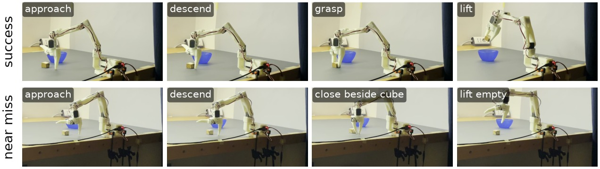

# How Many Demonstrations Does a €400 Robot Arm Need?

**Low training loss, low task success: diagnosing a perceptual bottleneck in imitation learning on the SO-101 arm.**

I built an SO-101 arm from parts, recorded three datasets of teleoperated demonstrations, trained four ACT policies with [LeRobot](https://github.com/huggingface/lerobot), and evaluated them on a pick-and-place task with a fixed protocol. The full write-up is in **[the report (PDF)](Report/so101_report_EN.pdf)**.



## Key findings

- **4× more data, no detectable gain.** Going from 24 to 100 demonstrations moves success from 1/15 to 2/15, and the Wilson confidence intervals overlap almost entirely.
- **Training converges, the task does not.** The final L1 loss is 10× below its initial value in every run, while success stays at 7–13%.
- **Most failures are near misses.** In 8–12 of 15 rollouts per model the motion is right but the gripper closes within about 1 cm of the cube. In longer rollouts the policy also notices a missed grasp and goes back to retry, a behaviour never shown in the demonstrations.
- **The likely cause is perceptual, not data-related.** At the moment of grasping, neither camera shows the gripper and the cube together. A redesigned, higher-contrast setup reduced complete failures (4 → 1, not significant at n = 15) but did not change the success rate.
- **A data-level failure, fixed at the source.** A first model never opened its gripper. The dataset statistics showed why: 61% of frames had the gripper closed. Changing how the demonstrations were recorded fixed it, without training longer.

| Model | Demos | Final L1 | Success | 95% CI | Points (/45) |
|---|---:|---:|---:|---:|---:|
| `act_so101_cube_v2_024` | 24 | 0.050 | 1/15 | 1–30% | 13 |
| `act_so101_cube_v2_100` | 100 | 0.076 | 2/15 | 4–38% | 16 |
| `act_so101_cube_v3_050` | 51 | ≈0.09 | 2/15 | 4–38% | 18 |

Points grade each rollout as success = 3, picked up but not deposited = 2, near miss = 1, failure = 0. See Section 4 of the report.

## Datasets and models

All of them are public on Hugging Face ([Fabyo04](https://huggingface.co/Fabyo04)).

| Dataset | Setup | Episodes | Models |
|---|---|---:|---|
| [`so101_cube_demo_0_20260926_155239`](https://huggingface.co/datasets/Fabyo04/so101_cube_demo_0_20260926_155239) | 2 | 100 | [`act_so101_cube_100`](https://huggingface.co/Fabyo04/act_so101_cube_100) |
| [`so101_cube_v2`](https://huggingface.co/datasets/Fabyo04/so101_cube_v2) | 2 | 100 | [`act_so101_cube_v2_024`](https://huggingface.co/Fabyo04/act_so101_cube_v2_024), [`act_so101_cube_v2_100`](https://huggingface.co/Fabyo04/act_so101_cube_v2_100) |
| [`so101_cube_v3`](https://huggingface.co/datasets/Fabyo04/so101_cube_v3) | 3 | 51 | [`act_so101_cube_v3_050`](https://huggingface.co/Fabyo04/act_so101_cube_v3_050) |

## Repository layout

```
Report/
  so101_report_EN.tex / .pdf   the report
  Evaluation results.xlsx      per-position evaluation outcomes and qualitative notes
  figures/                     every figure in the report (generated)
  media/                       photos and video stills used by the figures
scripts/
  make_report_figures.py       builds Report/figures/ from the public data + Report/media/
  extract_media_stills.py      one-off: extracts Report/media/ from the original recordings
  teleop.sh, record_test.sh, rollout_test.sh   the LeRobot commands used on the arm
configs/
  calibration/                 leader and follower calibration files
  ports.md                     serial ports and camera indices
```

## Reproducing

**Environment.** LeRobot 0.6.2 (commit `64b23178d5348609c266250d3e1f511eba4c33ff`), Python 3.12.13, PyTorch 2.11.0. Data collection and inference ran on a MacBook Air M1 (MPS); training ran on an NVIDIA T4. The exact record, train and rollout commands are in Appendix A of the report and in `scripts/`. The serial ports in the scripts are specific to my machine.

**Figures.** Every figure can be regenerated from this repository and the public datasets:

```bash
pip install matplotlib numpy pandas openpyxl huggingface_hub   # plus ffmpeg on PATH
python scripts/make_report_figures.py --cache ~/.cache/so101_report
```

`scripts/extract_media_stills.py` documents how the stills in `Report/media/` were taken from the original phone recordings. The recordings themselves are not published.

**Report.** `tectonic -X compile Report/so101_report_EN.tex`. Any XeLaTeX/LuaLaTeX setup with the Libertinus fonts also works.

## License

Released under the [MIT License](LICENSE): you are free to use, modify and redistribute the code, report and figures, with attribution.

## Acknowledgements

Built on the open-source [SO-100/SO-101](https://github.com/TheRobotStudio/SO-ARM100) design by TheRobotStudio and the [LeRobot](https://github.com/huggingface/lerobot) framework by Hugging Face.
